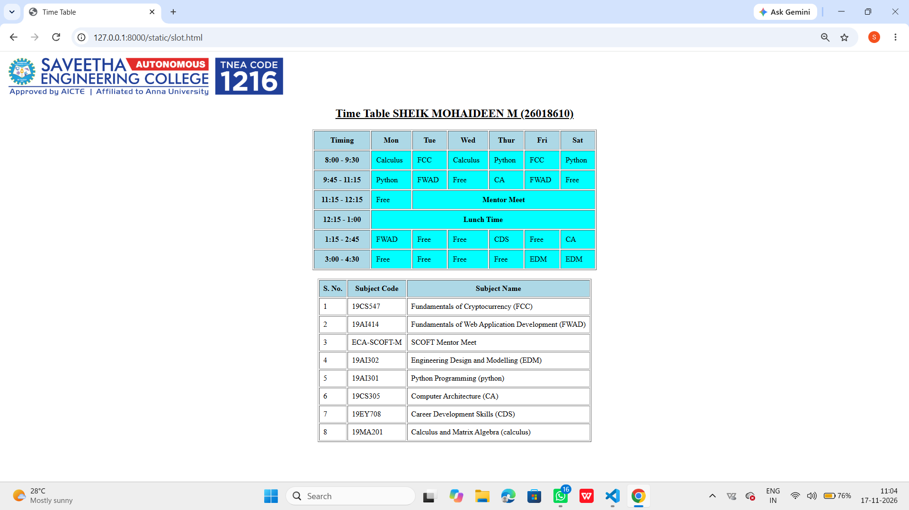

# Ex04 Time Table
## Date:17/11/2026

## AIM
To write a html webpage page to display your slot timetable.

## ALGORITHM
### STEP 1
Create a Django-admin Interface.

### STEP 2
Create an App inside the Django project.

### STEP 2
Create a static folder uder the created App and insert HTML code.

### STEP 3
Create a simple table using ```<table>``` tag in html with the relevant attributes.

### STEP 4
Add rows using ```<tr>``` tag.

### STEP 5
Add your course schedule using ```<td>``` tag.

### STEP 6
Execute the program using runserver command.

## PROGRAM
```
<html>
<head>
<title>Time Table</title>
</head>
<body>
   
<h2 align="center"><u>Time Table SHEIK MOHAIDEEN M (26018610)</u></h2>

<table border="1" cellpadding="10" width="600" align="center">
  <tr>
    <th bgcolor="lightblue">Timing</th>
    <th bgcolor="lightblue">Mon</th>
    <th bgcolor="lightblue">Tue</th>
    <th bgcolor="lightblue">Wed</th>
    <th bgcolor="lightblue">Thur</th>
    <th bgcolor="lightblue">Fri</th>
    <th bgcolor="lightblue">Sat</th>
  </tr>

  <tr bgcolor="cyan">
    <th bgcolor="lightblue">8:00 - 9:30</th>
    <td>Calculus</td>
    <td>FCC</td>
    <td>Calculus</td>
    <td>Python</td>
    <td>FCC</td>
    <td>Python</td>
  </tr>

  <tr bgcolor="cyan">
    <th bgcolor="lightblue">9:45 - 11:15</th>
    <td>Python</td>
    <td>FWAD</td>
    <td>Free</td>
    <td>CA</td>
    <td>FWAD</td>
    <td>Free</td>
  </tr>

  <tr bgcolor="cyan">
    <th bgcolor="lightblue">11:15 - 12:15</th>
    <td>Free</td>
    <th colspan="5"> Mentor Meet</th>
  </tr>

  <tr bgcolor="cyan">
    <th bgcolor="lightblue">12:15 - 1:00</th>
    <th colspan="6">Lunch Time</th>
  </tr>

  <tr bgcolor="cyan">
    <th bgcolor="lightblue">1:15 - 2:45</th>
    <td>FWAD</td>
    <td>Free</td>
    <td>Free</td>
    <td>CDS</td>
    <td>Free</td>
    <td>CA</td>
  </tr>

  <tr bgcolor="cyan">
    <th bgcolor="lightblue">3:00 - 4:30</th>
    <td>Free</td>
    <td>Free</td>
    <td>Free</td>
    <td>Free</td>
    <td>EDM</td>
    <td>EDM</td>
  </tr>
</table>

<br>

<table border="1" cellpadding="8" align="center">
  <tr>
    <th bgcolor="lightblue">S. No.</th>
    <th bgcolor="lightblue">Subject Code</th>
    <th bgcolor="lightblue">Subject Name</th>
  </tr>

  <tr>
    <td>1</td>
    <td>19CS547</td>
    <td>Fundamentals of Cryptocurrency (FCC)</td>
  </tr>

  <tr>
    <td>2</td>
    <td>19AI414</td>
    <td>Fundamentals of Web Application Development (FWAD)</td>
  </tr>

  <tr>
    <td>3</td>
    <td>ECA-SCOFT-M</td>
    <td>SCOFT Mentor Meet</td>
  </tr>

  <tr>
    <td>4</td>
    <td>19AI302</td>
    <td>Engineering Design and Modelling (EDM)</td>
  </tr>

  <tr>
    <td>5</td>
    <td>19AI301</td>
    <td>Python Programming (python)</td>
  </tr>

  <tr>
    <td>6</td>
    <td>19CS305</td>
    <td>Computer Architecture (CA)</td>
  </tr>

  <tr>
    <td>7</td>
    <td>19EY708</td>
    <td>Career Development Skills (CDS)</td>
  </tr>

  <tr>
    <td>8</td>
    <td>19MA201</td>
    <td>Calculus and Matrix Algebra (calculus)</td>
  </tr>
</table>
</body>
</html>

```

## OUTPUT



## RESULT
The program for creating slot timetable using basic HTML tags is executed successfully.
